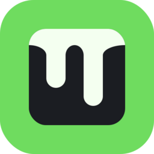
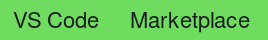

<p align="center">
  
</p>

<h1 align="center">🧩 vscode-goome 🧩</h1>

<p align="center">
<b>goome in VS Code for C, C#, Python, Java, Rust, Node, Go, Zig, Lua and Godot. Snippets, completion, docs when you hover, a new project command and a live preview for your .goome.json.</b>
</p>

<p align="center">
  
  <a href="https://marketplace.visualstudio.com/items?itemName=goome-ui.vscode-goome"></a>
  
  
</p>

<p align="center">
  Type <code>goome</code> in a C, C#, Python, Java, Rust, JavaScript, TypeScript, Go, Zig, Lua or GDScript file and you get the usual goome stuff, already using the real names and argument orders. Pick any of the ten languages in New Project and it makes you a working app from the template. Open a <code>.goome.json</code> from the UI builder and you can see it, and copy the code out of it, without leaving the editor.<br> <br>
  Do you like this project? If so, please let me know!
  <a href="https://sevvy-wevvy.com/discord">Discord</a>
</p>

<p align="center">
  <a href="https://goome-ui.github.io/docs/">Docs</a> &nbsp;·&nbsp;
  <a href="https://github.com/goome-ui/c-goome">goome</a> &nbsp;·&nbsp;
  <a href="https://goome-ui.github.io/docs/builder/">UI builder</a> &nbsp;·&nbsp;
  <a href="https://github.com/goome-ui/goome-cli">goome-cli</a>
</p>

<details>
<summary align="center"><b>⬇️ Easy Install ⬇️</b></summary>

<br>

<p align="center">
Its on the <a href="https://marketplace.visualstudio.com/items?itemName=goome-ui.vscode-goome">VS Code Marketplace</a>. Search <b>goome</b> in Extensions and hit Install, or from a terminal:
</p>

```sh
code --install-extension goome-ui.vscode-goome
```

<p align="center">
On VSCodium and the other forks it is on <a href="https://open-vsx.org/extension/goome-ui/vscode-goome">Open VSX</a>, or grab <code>vscode-goome-x.y.z.vsix</code> from the <a href="https://github.com/goome-ui/vscode-goome/releases/latest">latest release</a>, open Extensions, click the <b>...</b> at the top and pick <b>Install from VSIX...</b>
</p>
</details>

<details>
<summary align="center"><b>🚀 How To Use 🚀</b></summary>

<br>

<p align="center">
<b>Side bar</b> - click the goome icon in the activity bar. It has the quick actions, every <code>.goome.json</code> and <code>.goome-theme.json</code> in your workspace (click one to preview it), the templates for each language (click one and New Project starts with it picked) and a snippet cheat sheet that drops the snippet into your open file. The same file list also sits in the Explorer under your files<br>
<b>Snippets</b> - type <code>goome</code> and pick one. <code>goome-overlay</code> and <code>goome-app</code> are a whole program, <code>goome-loop</code> is the poll and pace loop, and theres one for every common widget, plus <code>goome-style</code>, <code>goome-custom</code>, <code>goome-offscreen</code>, <code>goome-hotkey</code>, <code>goome-theme-preset</code>, <code>goome-theme-make</code>, <code>goome-anim</code>, <code>goome-anim-color</code>, <code>goome-ease</code>, <code>goome-text-input</code>, <code>goome-a11y</code>, <code>goome-font-fallback</code> and <code>goome-text-dir</code>. Same names in every language (Godot has 56, it doesnt have an overlay, hotkey or offscreen one because a GoomeView node does that part)<br>
<b>goome: New Project</b> - pick a language (C, C#, Python, Java, Godot, Rust, Node, Go, Zig or Lua), a template (<code>app</code>, <code>overlay</code>, <code>mod-menu</code> or <code>hud</code>, all four exist for all ten), a folder and a name. It runs <a href="https://github.com/goome-ui/goome-cli">goome-cli</a> and opens what it made. If <code>goome</code> isnt on your PATH it downloads goome.py from the latest goome-cli release and runs that with Python, so you dont have to install anything besides Python<br>
<b>goome: Build for Web</b> - compiles a C app to webassembly with <code>goome build --web</code>, from the command palette, the button at the top of a <code>.c</code> file, the right click menu or the side bar. The output goes in a <code>web</code> folder next to the file, errors show up as a message with the full output in the goome output panel. When it works pick <b>Open in browser</b> (runs <code>goome serve</code> on localhost) or <b>Reveal folder</b>. <b>goome: Stop Web Server</b> stops it, and it stops when VS Code closes. Needs <code>clang</code> and <code>wasm-ld</code>, apps only, and your app has to have <code>goome_web_init</code> and <code>goome_web_frame</code> (see <a href="https://github.com/goome-ui/c-goome/tree/dev/wasm/web">wasm/web</a>). Released c-goome versions dont have the web build yet, so set <code>goome.web.goomePath</code> to a c-goome checkout<br>
<b>Preview</b> - open a <code>.goome.json</code> and hit the preview button at the top right (or <b>goome: Open Preview</b>). It draws the project with the UI builders own code and updates while you type. Its read only, <b>Open in the UI builder</b> takes you to the real thing<br>
<b>Copy code</b> - the C, C#, Python, Java, Godot, Rust, Node, Go, Zig and Lua buttons in the preview (or <b>goome: Copy Code From This Project</b>) put the builders generated code on your clipboard.<br>
<b>Hover</b> - hover any <code>goome_*</code> function in C and you get its signature, the note from goome.h and a link to the docs. In Rust, JavaScript, TypeScript, Go, Zig, Lua and GDScript hover a goome method or constant (<code>ui.button</code>, <code>goome::open</code>, <code>GoomeUI.WIN_MOVE</code>) and you get the real signature from that binding, plus the goome.h note and docs link when theres a C function behind it. It only kicks in in files that mention goome<br>
<b>Completion</b> - in those same seven languages type <code>ui.</code>, <code>g.</code>, <code>c.</code>, <code>goome.</code> (<code>ui:</code> in Lua, <code>goome::</code> in Rust) and you get that objects methods and constants with their signatures. C, C# Python and Java only complete the snippets<br>
<b>Schemas</b> - <code>.goome.json</code> and <code>.goome-theme.json</code> get checked while you edit them, so typos in widget types, theme fields and colors show up right away<br> <br>
Settings: <code>goome.cli</code> points at your own <code>goome</code> or <code>goome.py</code>, <code>goome.python</code> picks the Python it runs with, <code>goome.web.goomePath</code> is the c-goome checkout that Build for Web uses.
</p>
</details>

<details>
<summary align="center"><b>🌍 What Works In Which Language 🌍</b></summary>

<br>

<p align="center">
Every language gets snippets and New Project. The rest depends on the binding, and this is what is really there right now:
</p>

<div align="center">

| Language | Editor ids | Snippets | Completion | Hover | New Project | Copy code | Build for Web |
|:--|:--|:--:|:--:|:--:|:--:|:--:|:--:|
| C | c, cpp | 58 | snippets only | yes | yes | yes | yes |
| C# | csharp | 58 | snippets only | no | yes | yes | no |
| Python | python | 58 | snippets only | no | yes | yes | no |
| Java | java | 58 | snippets only | no | yes | yes | no |
| Godot | gdscript | 56 | yes | yes | yes | yes | no |
| Rust | rust | 58 | yes | yes | yes | yes | no |
| Node | javascript, typescript (and the react ones) | 58 | yes | yes | yes | yes | no |
| Go | go | 58 | yes | yes | yes | yes | no |
| Zig | zig | 58 | yes | yes | yes | yes | no |
| Lua | lua | 58 | yes | yes | yes | yes | no |

</div>

<p align="center">
<b>Build for Web</b> is C only for now, it compiles a C app with <code>goome build --web</code>.<br>
<b>Copy code</b> comes from the UI builder, which writes all ten languages.<br>
Node has an <code>index.d.ts</code>, so TypeScript gets the same snippets, completion and hover as JavaScript.<br>
The VS Code side of Rust, Go, Zig, Lua and GDScript (syntax colors, rust-analyzer, gopls and so on) comes from their own extensions, goome only adds the goome parts. It registers the <code>.rs</code>, <code>.go</code>, <code>.zig</code>, <code>.lua</code> and <code>.gd</code> language ids so the snippets still work if you dont have those installed.<br>
The names for hover and completion are read out of the bindings when the extension is built, so they follow what the bindings really have.
</p>
</details>

<details>
<summary align="center"><b>🔨 Building It 🔨</b></summary>

<br>

<p align="center">
It wants <a href="https://github.com/goome-ui/docs">goome-ui/docs</a> and <a href="https://github.com/goome-ui/c-goome">c-goome</a> next to this folder (or <code>GOOME_DOCS</code> and <code>GOOME_C</code> set). The build copies the builder out of docs and makes the hover list out of goome.h. The Rust, Node, Go, Zig, Lua and Godot names come out of <code>rust-goome</code>, <code>node-goome</code>, <code>go-goome</code>, <code>zig-goome</code>, <code>lua-goome</code> and <code>godot-goome</code> the same way (<code>GOOME_RUST</code>, <code>GOOME_NODE</code> and so on if they live somewhere else).
</p>

```sh
npm ci
npm run compile
npm run unit
npm test
npx @vscode/vsce package
```

<p align="center">
<code>npm test</code> opens a real VS Code. On linux run it under <code>xvfb-run -a</code> so it doesnt pop up on your desktop.
</p>
</details>

<details>
<summary align="center"><b>🛠 Pull Requests 🛠</b></summary>

<br>

<p align="center">
Want to help with vscode-goome? Make A pull request to <b>dev</b>!<br>
Pull request allow for anyone to request a change to this code. In turn meaning that <b>YOU</b> can contribute to this project.<br> <br>
As long as it works, and doesnt vary off too far from the main idea its very likely it get accepted!<br>
Read <a href="CONTRIBUTING.md">CONTRIBUTING.md</a> before you send one.
</p>
</details>

<details>
<summary align="center"><b>⚖️ License ⚖️</b></summary>

<br>

<p align="center">
vscode-goome is under the <a href="LICENSE">GPL-3.0</a>.<br> <br>
<sub>
• You can use it, change it and share it<br>
• If you share something made with it, you have to share your source too, under the same license<br>
• Keep the credits
</sub><br> <br>
In short: play fair, keep it open, and give credit where it's due.
</p>
</details>

<details>
<summary align="center"><b>🩷 Donate 🩷</b></summary>

<br>

<p align="center">
<a href="https://sevvy-wevvy.com/kofi">Ko-fi</a> (Preferred)<br>
<a href="https://sevvy-wevvy.com/patreon">Patreon</a><br>
<a href="https://sevvy-wevvy.com/throne">Throne</a>
</p>
</details>
